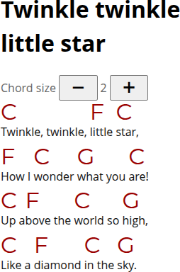

# Big Chords

`js/split.js` turns a chord sheet inside a `<pre>` element into responsive HTML fragments. It expects lines in pairs: a chord line followed by a lyric line. Chords and lyrics are split at matching character columns, so they stay aligned as the fragments wrap. If the page includes a `.chord-size-control`, its <kbd>+</kbd> and <kbd>−</kbd> buttons adjust the chord size.

Cyrillic `А`, `В`, `С`, `Е`, and `Н` are converted to Latin `A`, `B`, `C`, `E`, and `H` at the start of a chord and after `/`. Within chord tokens, Cyrillic soft signs (`Ь`/`ь`) and lowercase Latin `b` after an uppercase Latin letter become `♭`, and `#` becomes `♯`.

The parser separates a chord into its root note, quality suffix, and optional bass note after `/`. It returns `source`, `root` (`letter`, `accidental`, and `pitchClass`), `quality`, `bass` (or `null`), `normalized`, and `notationSystem` fields. Tokens with an unrecognized root or bass are displayed as written.

Set `CHORD_NOTATION_SYSTEM` in `js/split.js` to `"english"`, `"german"`, or `"auto"`. English notation treats `B` as B natural; German notation treats `B` as B-flat and `H` as B natural. In automatic mode, an `H` root or bass selects German notation, while a B-flat root or bass selects English notation. If neither clue appears, or both appear, the system remains unresolved; `B` and `H` then have no `pitchClass` until a system is selected manually.

Set `CHORD_ENHARMONIC_PREFERENCE` to `"sharps"`, `"flats"`, or `"as-is"` to choose the default spelling. A page with an `.enharmonic-control` radio group uses its current selection instead. The preference applies to the root and optional slash bass while preserving the chord quality. Notes whose pitch class is unresolved stay as written.

An optional `.notation-system-control` radio group switches the displayed notation between English (`B♭`/`B`) and German (`B`/`H`).

Run the notation detection and chord parsing tests with `npm test` (Node.js 18 or newer).

## How to use it

Add the script and stylesheet to an HTML page containing a chord sheet, then open the page in a browser.

## Example

Link the stylesheet and script from an HTML page:

```html
<link rel="stylesheet" href="css/style.css">
<script src="js/split.js" defer></script>

<pre data-chord-lines>C                 F      C
Twinkle, twinkle, little star,
F     C      G        C
How I wonder what you are!</pre>
```

Optionally, add a chord-size control:

```html
<div class="chord-size-control">
  Chord size
  <button
    type="button"
    id="chord-size-decrease"
    aria-label="Shrink chords">
    −
  </button>
  <output id="chord-size-value" aria-live="polite">2</output>
  <button
    type="button"
    id="chord-size-increase"
    aria-label="Enlarge chords">
    +
  </button>
</div>
```
The result looks like this:



## Data attributes

Set options on the `<script>` element to provide defaults, or on a specific `<pre data-chord-lines>` to override them for that chord sheet. When both elements define the same option, the `<pre>` value takes precedence. These values set the initial options and update matching controls; the controls remain available for changing settings while the page is open.

- `data-notation-system`: how to read chord names; `auto`, `english`, or `german`.
- `data-enharmonic-preference`: how to spell enharmonic notes; `as-is`, `sharps`, or `flats`.
- `data-display-notation-system`: which note-name system to use when displaying chords; `english` or `german`.
- `data-chord-size`: initial chord size, from `1` to `6`.

Chord-size radio buttons may omit `value`; when they do, the script reads the size (`1`–`6`) from the text in the wrapping `<label>`.

For example, set defaults on the script and choose German display notation for one chord sheet:

```html
<script
  src="../js/split.js"
  defer
  data-notation-system="auto"
  data-enharmonic-preference="as-is"
  data-display-notation-system="english"
  data-chord-size="2"></script>

<pre data-chord-lines data-display-notation-system="german" data-chord-size="4">Bbm/Db
Example lyrics</pre>
```

## Controls

It is possible to use radio buttons to control all parameters listed above:

```html
<div class="song-controls">
  <fieldset class="chord-size-control">
    <legend>Chord size</legend>
    <label><input type="radio" name="chord-size"> 1</label>
    <label><input type="radio" name="chord-size" checked> 2</label>
    <label><input type="radio" name="chord-size"> 3</label>
    <label><input type="radio" name="chord-size"> 4</label>
    <label><input type="radio" name="chord-size"> 5</label>
    <label><input type="radio" name="chord-size"> 6</label>
  </fieldset>
  <fieldset class="enharmonic-control">
    <legend>Chord spelling</legend>
    <label>
      <input type="radio" name="enharmonic-preference" value="flats">
      ♭
    </label>
    <label>
      <input type="radio" name="enharmonic-preference" value="as-is" checked>
      as is
    </label>
    <label>
      <input type="radio" name="enharmonic-preference" value="sharps">
      ♯
    </label>
  </fieldset>
  <fieldset class="notation-system-control">
    <legend>Notation system</legend>
    <label>
      <input type="radio" name="display-notation-system" value="english" checked>
      English (B♭)
    </label>
    <label>
      <input type="radio" name="display-notation-system" value="german">
      German (H)
    </label>
  </fieldset>
</div>
```

## Examples

Examples are in the `samples/` directory:

- [Jingle Bells](samples/jingle-bells.html) — minimal example
- [Jingle Bells — all-in-one](samples/jingle-bells-offline.html) (see below)
- [The One Horse Open Sleigh — full example](samples/one-horse-open-sleigh.html), with all three settings configurable: chord size, enharmonic spelling, and displayed notation system.
- [The One Horse Open Sleigh — German notation preset](samples/one-horse-open-sleigh-german.html), with German display notation selected through a `data-` attribute.

For pages in `samples/`, use the paths `../css/style.css` and `../js/split.js`.

## Troubleshooting

The page has been tested in Google Chrome 156 on desktop.

When opened through an Android file picker, mobile browsers such as Google Chrome and Mi Browser may not load the page's external script and stylesheet.

### Possible solutions

Use the [all-in-one version](samples/jingle-bells-offline.html), which includes the script and stylesheet in the HTML file.

Or serve the files over HTTP. For example, run one of these commands from the project root:

```bash
php -S localhost:8000
```

Or, with Python:

```bash
python3 -m http.server 8000
```

You can also use [Simple HTTP Server: Wi-Fi Share](https://apps.ubi.jp/en/apps/simple-http-server/), available on [Google Play](https://play.google.com/store/apps/details?id=jp.ubi.common.http.server).

To open the page in a browser on the same phone, set **Network interface** to `localhost only`. Use `Wi-Fi only` to access the server from another device on the same network, or `All networks` for both. Restart the server if the app asks you to.

After starting the server from the project root, open http://localhost:8000/samples/jingle-bells.html in your browser.

## Available on GitHub

The project is hosted at [github.com/shoorick/big-chords](https://github.com/shoorick/big-chords).

Feel free to [report issues](https://github.com/shoorick/big-chords/issues).

## Author

Alexander Sapozhnikov <shoorick@cpan.org>

## License

The project's source code is available under the MIT License; see [LICENSE](LICENSE). Song lyrics and other third-party material in `samples/` are not covered by this license.
